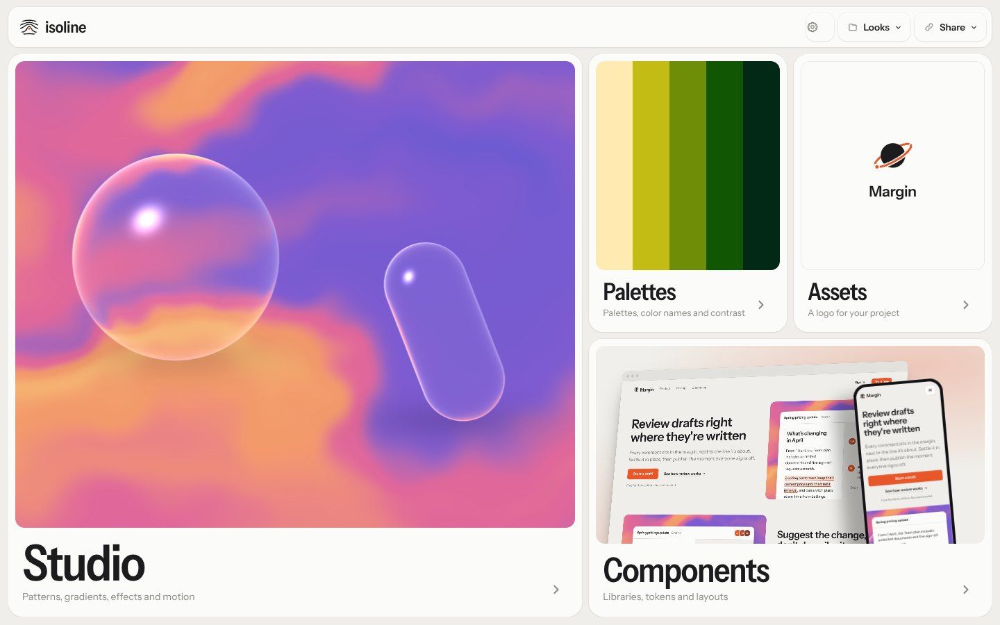
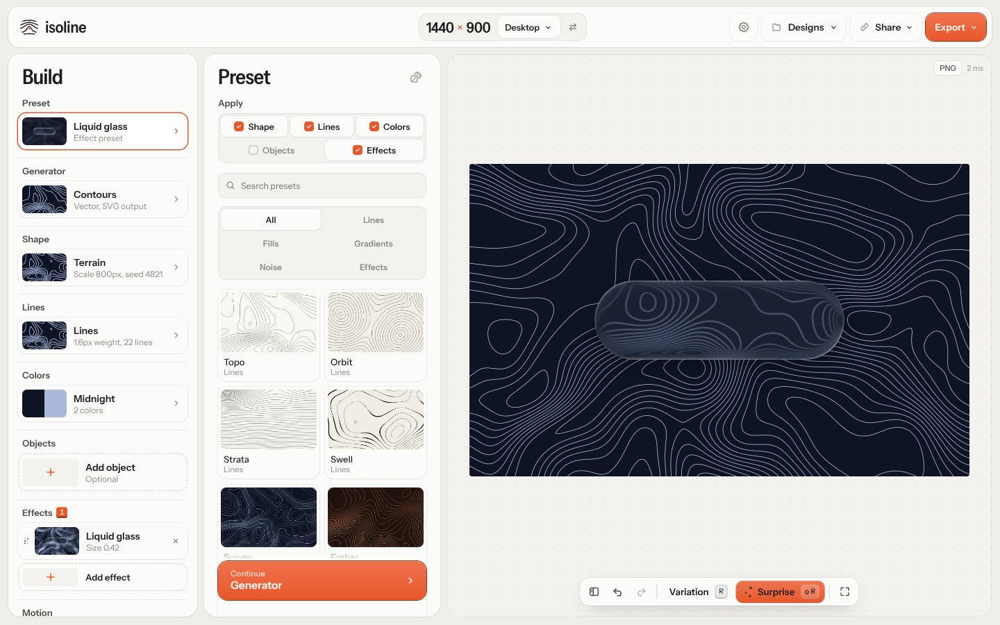
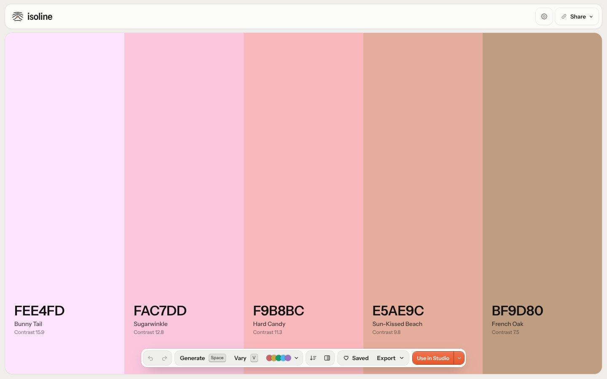
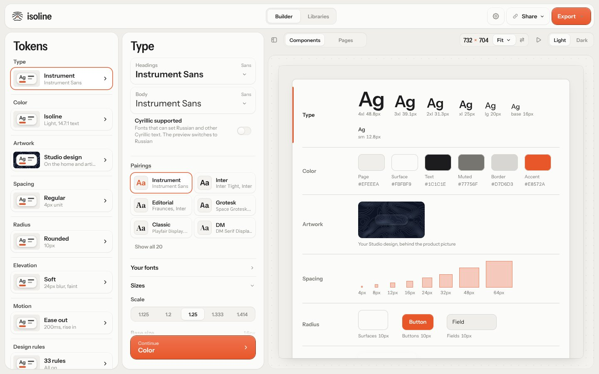
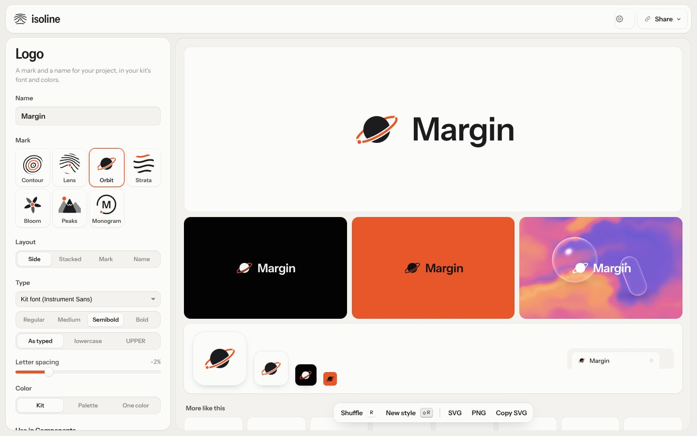
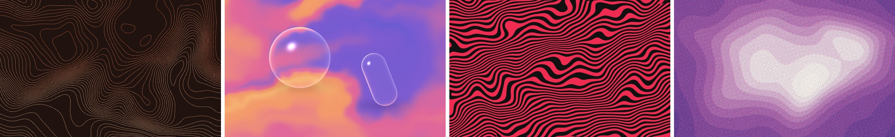

<div align="center">


# Isoline

**Topographic patterns, gradients, palettes, design tokens and logos, in one browser tab.**
Make a background, pick its colors and turn it into a kit, without fighting Figma.

[](https://masterclaudecoder.github.io/isoline/)
[](https://github.com/masterclaudecoder/isoline/actions/workflows/pages.yml)


`generative-art` · `topography` · `contours` · `gradients` · `shaders` · `color-palettes` · `design-tokens` · `logo-maker` · `svg` · `webgl`

<br>

<picture>
  <source media="(prefers-color-scheme: dark)" srcset="docs/home-dark.jpg">
  
</picture>

</div>

## What's inside

<table>
<tr>
<td width="50%" valign="top">

### Studio
Contour lines, gradients, noise fields and auras, with 3D objects, a stack of WebGL effects and looping motion. Export SVG, PNG, MP4, GIF or WebP.

</td>
<td width="50%"></td>
</tr>
<tr>
<td valign="top">

### Palettes
Press Space for new colors in OKLCH harmonies, lock the ones you like, and read each color's name and contrast. Curated and brand palettes are included.

</td>
<td></td>
</tr>
<tr>
<td valign="top">

### Components
A token builder (type, color, spacing, radius, elevation, motion) previewed on real pages, with CSS, Tailwind and JSON export. A directory of about 120 UI libraries sits next to it.

</td>
<td></td>
</tr>
<tr>
<td valign="top">

### Assets
A logo maker: a mark in one of seven drawn styles plus your project's name, set in the kit's font and colors. Preview it on dark, on your accent, over your design and as an app icon, then export SVG or PNG. It can stand in for the kit's logo in Components.

</td>
<td></td>
</tr>
</table>

**Roll a whole look** by clicking the logo on the home page: a new palette, design, kit and logo at once. Hold the logo to keep rolling every 8 seconds.



## Run it

It's a static site with no build step and no dependencies to install.

```sh
python3 -m http.server
# then open http://localhost:8000
```

## Deploy

Changes go to `main` through pull requests. Each pull request runs the site build as a check, and merging deploys `main` to GitHub Pages ([`pages.yml`](.github/workflows/pages.yml)).

## For agents

**Share → Copy for agents** copies a guide to the app. Scripts and agents can drive everything through `window.Isoline` (`studio`, `palettes`, `components`, `assets`, `go`, `guide()`).

## Project

| | |
|---|---|
| `app.js` · `engine.js` · `fx.js` | Studio, the contour engine (no DOM), WebGL generators and effects |
| `palette.js` · `color.js` · `colornames.js` | Palette tool, color math, color names |
| `components.js` · `libs.js` | Token builder and the library directory |
| `assets.js` | Logo maker |
| `shell.js` · `ui.js` · `glass.js` · `tour.js` | Pages and transitions, shared motion, glass bars, tutorials |
| `i18n.js` · `ru.js` | Russian translation |
| `tools/` | Library preview capture, preset thumbnails, tooltip recordings |
| `worker/` | Optional Cloudflare Worker for in-app feedback ([setup](worker/README.md)) |

Design principles and the pre-ship checklist: [DESIGN.md](DESIGN.md).

Uses [mp4-muxer](https://github.com/Vanilagy/mp4-muxer) (MIT) for video export.
