<h1 align="center">Isoline</h1>

<p align="center">Patterns, gradients, effects, palettes and design tokens in one browser tab.</p>

<p align="center">
  <a href="https://masterclaudecoder.github.io/isoline/"></a>
</p>

<p align="center">
  
  
  
  
  
  <a href="https://github.com/masterclaudecoder/isoline/actions/workflows/pages.yml"></a>
</p>

<p align="center">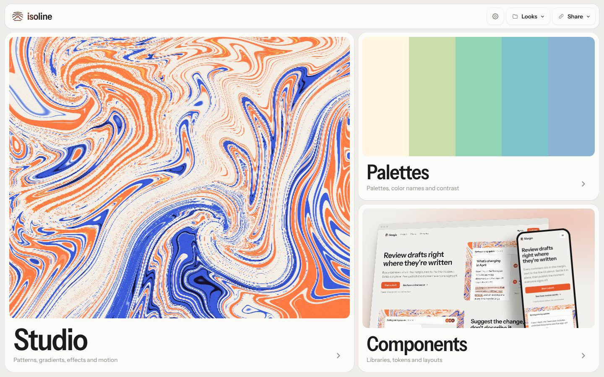</p>

## Made in the Studio

<p align="center">
  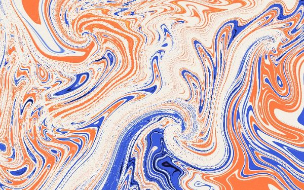
  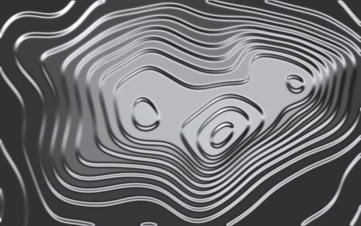
  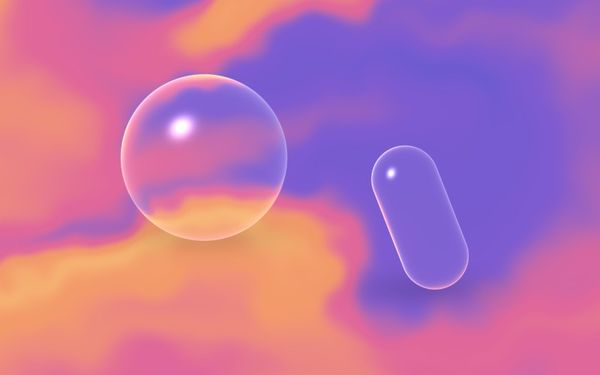
  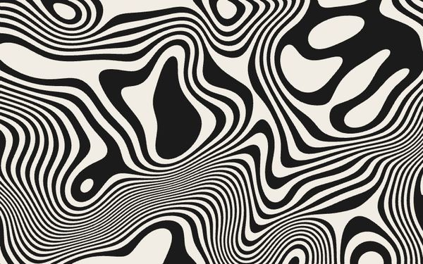
  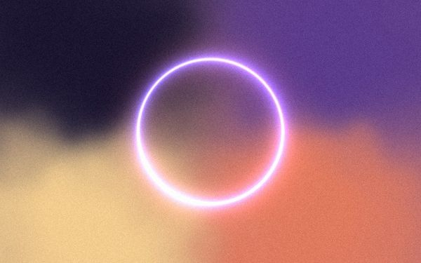
  
  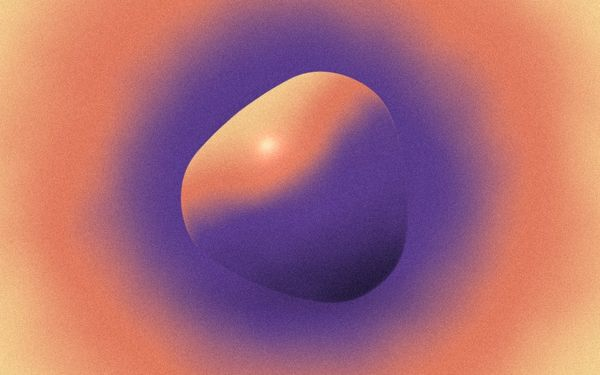
  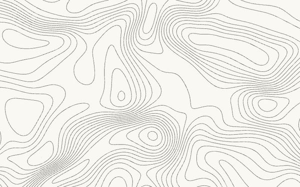
  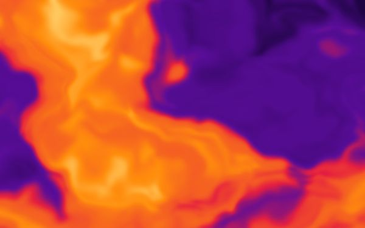
</p>

## Three tools

| Studio | Palettes | Components |
| :-- | :-- | :-- |
| 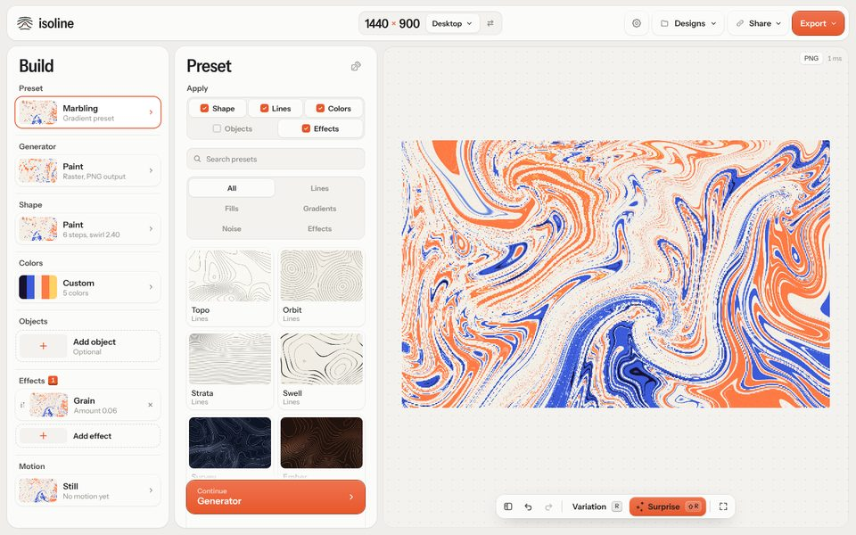 | 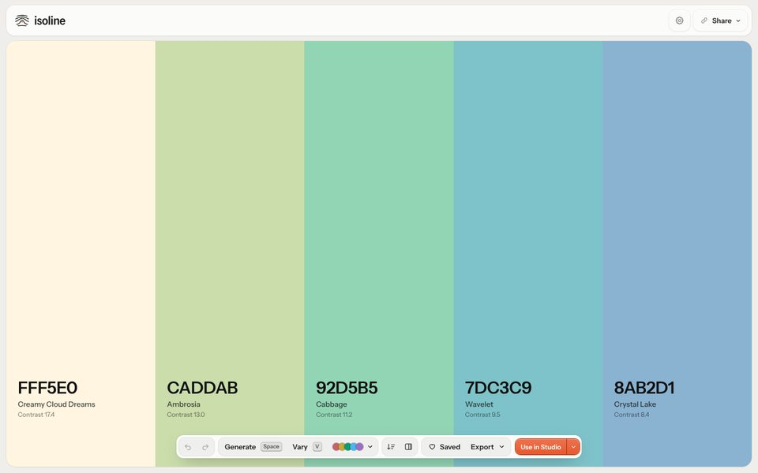 | 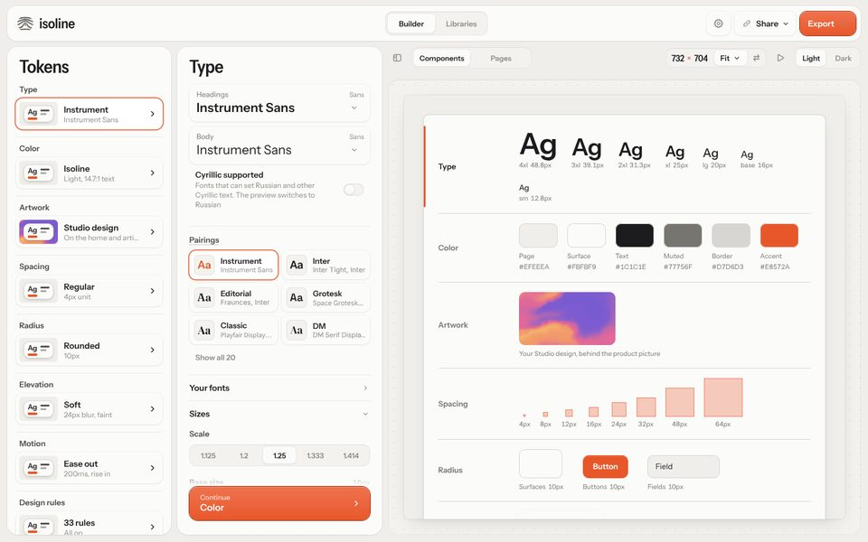 |
| Contours, 9 gradient generators, 50 stackable effects, 3D glass objects and looping motion. | Press Space for a new palette. Lock what you like, export hex, CSS or JSON. | Type, color, spacing and motion tokens on a live product mockup, plus a directory of about 120 libraries. |

Click the logo on the home page to roll a new look across all three.

## Run it

```sh
python3 -m http.server
```

Then open `localhost:8000`. No install, no bundler. Agents can drive the app through `window.Isoline` (see **Share → Copy for agents**).

Design rules live in [DESIGN.md](DESIGN.md). Pull requests into `main` deploy to GitHub Pages.
